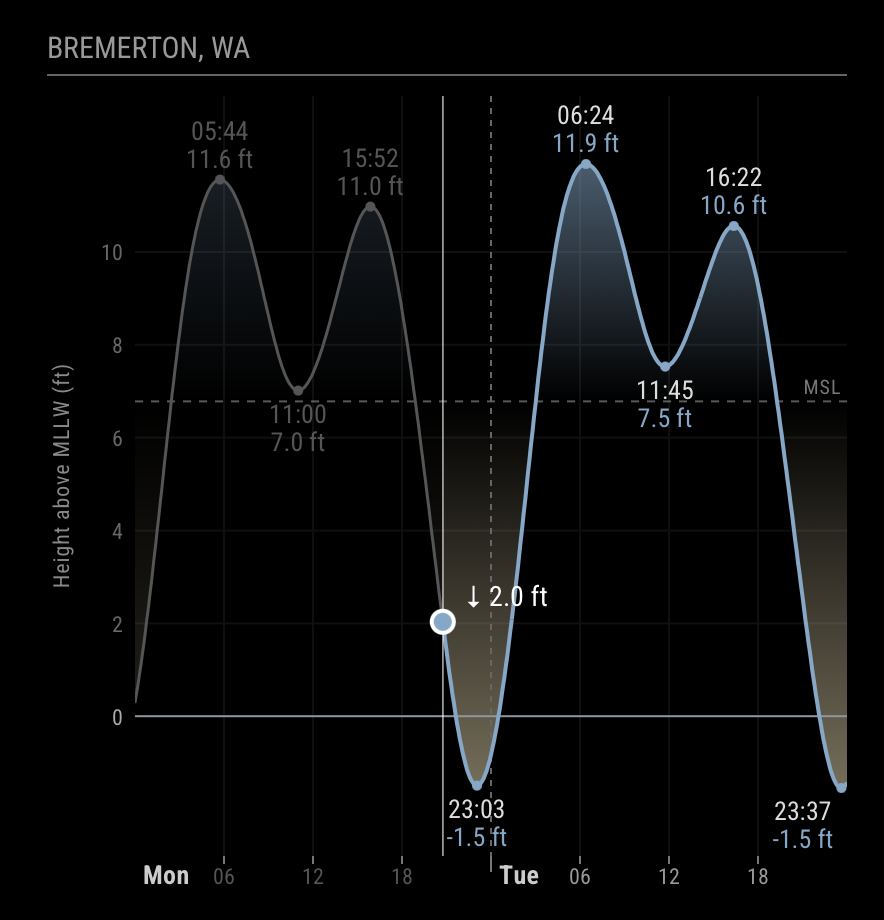

# MMM-TideChartSVG

A [MagicMirror²](https://github.com/MagicMirrorOrg/MagicMirror) module that shows a tide chart
for one NOAA station, covering today and tomorrow (local time). High and low tides are labeled
with their time and height, and a marker shows the current time and tide level.

The chart is drawn as a lightweight SVG with no charting library, so it runs well on small
hardware such as a Raspberry Pi 3B+.



## What it shows

- **The tide curve** for today and tomorrow, with the hours already gone greyed out.
- **Highs and lows**, labeled with their time (24-hour) and height.
- **Now:** a vertical line and a dot on the curve, with the current height and whether the tide
  is rising (↑) or falling (↓).
- **A height scale** on the left, labeled with what it measures (e.g. "Height above MLLW (ft)"),
  a line at 0, and a faint grid.
- **Shading under the curve:** blue, fading toward the bottom. If you set `meanSeaLevel`, a
  dashed line marks mean sea level and the shading shows how far the tide is above it (blue) or
  below it (sand), fading toward the line.
- **Extreme tides** (optional, `extremeRange`): highs above or lows below your range get their
  label on a red (high) or purple (low) badge.
- **The station's name** as the module's header (from NOAA), unless you set your own `header`.

## Data

Tide predictions come from NOAA's [Tides & Currents](https://tidesandcurrents.noaa.gov/) API
(free, no key needed). Find your station's ID on the
[station map](https://tidesandcurrents.noaa.gov/map/index.html).

Data is fetched when MagicMirror starts and again at 00:01 local time each day. If a fetch
fails, the module keeps the last chart, shows "(latest update failed)", and retries every hour.
The station's name comes from NOAA's station information; if that one request fails, the
header shows the station ID instead.

## Installation

```sh
cd ~/MagicMirror/modules
git clone <this repository's URL> MMM-TideChartSVG
```

No `npm install` is needed: the module has no dependencies.

## Configuration

Add the module to `config/config.js`:

```js
{
  module: "MMM-TideChartSVG",
  position: "top_center",
  config: {
    stationID: "9445958", // Bremerton, WA
    timezone: "America/Los_Angeles",
    meanSeaLevel: 6.78,
    extremeRange: [-3.0, 13.0]
  }
}
```

| Option | Default | Description |
| --- | --- | --- |
| `stationID` | *(required)* | NOAA tide station ID. |
| `stationName` | NOAA's name | Name shown in the header, e.g. `"Bremerton Marina"`. A `header` set on the module entry wins over both. |
| `timezone` | the mirror's timezone | IANA timezone name, e.g. `"America/Los_Angeles"`. Sets which two calendar days are shown and the times on the labels. |
| `units` | `"english"` | `"english"` (feet) or `"metric"` (meters). |
| `datum` | `"MLLW"` | NOAA height baseline ([datum options](https://tidesandcurrents.noaa.gov/datum_options.html)). MLLW (mean lower low water) is the usual baseline for tide charts. |
| `meanSeaLevel` | none | Height of mean sea level, in the chart's units and datum (e.g. `6.78` ft above MLLW). Adds the dashed MSL line and shades above/below it. Look it up on the station's NOAA "Datums" page: MSL minus your datum (e.g. MSL − MLLW). |
| `gridStep` | `2` ft / `0.5` m | Height between grid lines, in the chart's units. |
| `extremeRange` | none | `[low, high]`, e.g. `[-3.0, 13.0]`. Lows below `low` and highs above `high` get a colored badge. |
| `width` | `400` | Chart width in pixels. |
| `height` | `400` | Chart height in pixels. |
| `overlayUpdateInterval` | `60000` | How often the current-time marker moves, in milliseconds. |

The height scale always includes 0 (and `meanSeaLevel` when set), so the zero line is always on
the chart.

## Limitations

- **One station per mirror.** Only the first instance's station is used. A second instance
  with a different station shows "Only one tide station per mirror is supported."
- Heights are NOAA's predictions only. They don't include weather effects such as storm surge.

## Development

Tests use Node's built-in test runner. From the module directory:

```sh
node --test
```

## License

MIT. See [LICENSE.md](LICENSE.md).
