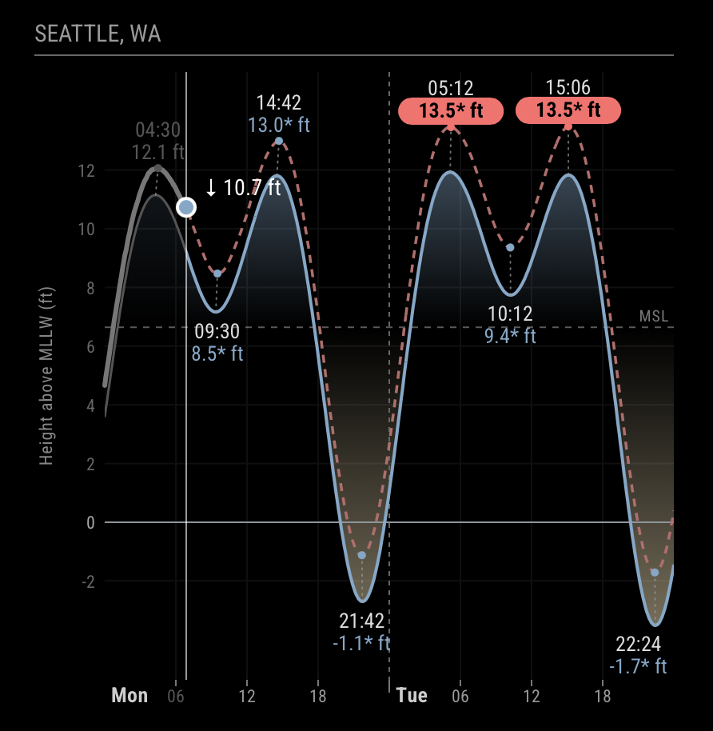

# MMM-TideChartSVG

A [MagicMirror²](https://github.com/MagicMirrorOrg/MagicMirror) module that shows a tide chart
for one NOAA station, covering today and tomorrow (local time). High and low tides are labeled
with their time and height, the water level NOAA has measured so far is drawn over the
predicted curve, and a marker shows the current time and water level. Optionally, when NOAA's
storm surge model expects the water to differ a lot from the tide prediction, its forecast is
drawn too.

The chart is drawn as a lightweight SVG with no charting library, so it runs well on small
hardware such as a Raspberry Pi 3B+.



## What it shows

- **The tide curve** for today and tomorrow, with the hours already gone greyed out.
- **Highs and lows**, labeled with their time (24-hour) and height.
- **Observed water level:** a thicker grey line showing what NOAA's gauge has measured since
  the start of today. Weather (wind, air pressure, river flow) often pushes the real water a
  foot or more above or below the prediction, and this line shows by how much.
- **Observed highs and lows:** once a high or low has passed and the readings show the water
  has turned (at least 30 minutes after the highest or lowest reading), its label shows the
  observed time and height instead of the predicted ones. A faint dotted line joins the
  predicted point to the observed one, and the label sits outside both: above the higher point
  for a high, below the lower one for a low.
- **Storm surge forecast** (optional, `etssThreshold`): a muted red dashed line from now on,
  showing the water level the NWS storm surge model (ETSS) expects, when it differs enough from
  the prediction. Upcoming highs and lows are then labeled with the forecast values, marked
  with an asterisk right after the number (e.g. `12.4* ft`), with the same dotted line to the
  predicted point. See [Storm surge forecast](#storm-surge-forecast-etss).
- **Now:** a vertical line and a dot, with the current height and whether the tide is rising
  (↑) or falling (↓). The height is the latest observed reading when it is less than an hour
  old, otherwise the predicted height. The arrow follows the predicted curve.
- **A height scale** on the left, labeled with what it measures (e.g. "Height above MLLW (ft)"),
  a line at 0, and a faint grid.
- **Shading under the curve:** blue, fading toward the bottom. If you set `meanSeaLevel`, a
  dashed line marks mean sea level and the shading shows how far the tide is above it (blue) or
  below it (sand), fading toward the line.
- **Extreme tides** (optional, `extremeRange`): highs above or lows below your range get their
  height on a red (high) or purple (low) pill; once in the past, the pill becomes an outline.
- **The station's name** as the module's header (from NOAA), unless you set your own `header`.
  An asterisk after the header (e.g. "Eagle Harbor, WA\*") means the curve
  is modeled from another station; see [Subordinate stations](#subordinate-stations).

## Data

Tide predictions come from NOAA's [Tides & Currents](https://tidesandcurrents.noaa.gov/) API
(free, no key needed). Find your station's ID on the
[station map](https://tidesandcurrents.noaa.gov/map/index.html).

When MagicMirror starts, the module looks up the station once: its name (for the header) and
whether it is a subordinate station (below). Both are needed, so until this works the module
shows the error and tries again every hour. The station is not looked up again until
MagicMirror restarts.

Predictions are fetched at the same time and again at 00:01 local time each day. If a fetch
fails, the module keeps the last chart, shows "(latest update failed)", and retries every hour.
If the station record has no name, the header shows the station ID.

Observed water levels come from the same API (NOAA's 6-minute readings, which appear about
5 minutes after they're measured). They're fetched at startup and then every 15 minutes
(`observationInterval`); each fetch covers today from 00:00 to now. These are NOAA's
preliminary readings, not yet checked. If a fetch fails, the module keeps the line it has and
tries again at the next interval, without showing an error. If the latest reading is more than
6 hours old, a note under the chart says so (e.g. "Observations not updated since Mon 08:12").
A station without a water level gauge simply shows no observed line.

### Subordinate stations

Some NOAA stations, such as Eagle Harbor (`9445882`), are *subordinate*
stations. NOAA publishes only their highs and lows, not a tide curve. It calculates those highs
and lows from a nearby reference station (for Eagle Harbor, Seattle, `9447130`) with two fixed
corrections, one for highs and one for lows: a time shift in minutes and a height ratio.
Eagle Harbor's highs are 4 minutes later and ×1.00; its lows 5 minutes later and ×1.02.

For a subordinate station the module:

- labels the station's own highs and lows, as NOAA publishes them;
- draws the curve from the reference station's curve, with the same corrections applied;
- adds an asterisk to the header (whatever the header text) to show the curve is modeled;
- draws the reference station's observed water level with the same corrections (subordinate
  stations have no gauge of their own), so the observed line is modeled too.

The modeled curve passes through NOAA's published highs and lows. Between them, it is an
estimate:

- **NOAA defines the corrections only at highs and lows.** Every point in between still needs a
  time shift and height ratio. The module blends from one tide's correction to the next **by
  time**: halfway in time from a high to the next low, a point gets halfway between the high's
  and the low's correction. (Blending by height, i.e. by how far the water has risen or fallen,
  is the other reasonable choice. It was rejected as slightly more complex for no visible gain.)
- **What that means:** for stations whose two corrections are close, the choice makes no
  visible difference. For Eagle Harbor the two blends differ by at most 0.03 ft. For a station
  whose high and low corrections differ a lot (say, highs +30 min ×0.9 and lows +2 h ×1.3), the
  in-between part of the curve is less certain, and other reasonable methods would draw it
  somewhat differently.
- The shape between highs and lows is the reference station's shape. For a subordinate station
  far from its reference station, the real shape may differ.

If any request for a subordinate station fails (its highs and lows, or the reference station's
data), the module treats the whole fetch as failed rather than draw a less accurate curve.

### Storm surge forecast (ETSS)

Tide predictions are astronomical: they don't know about the weather. Wind, low air pressure
and river flow can push the water a foot or more above (or below) the prediction for days.
NOAA's National Weather Service runs a model for this, **ETSS** (Extra-Tropical Storm Surge),
four times a day. It forecasts the water level about four days ahead at about 565 NOAA
stations: the tide, plus the modeled surge, plus a correction from the last few days of
observations.

The module can draw that forecast, but only when it matters. Set `etssThreshold` to a height
in the chart's units. Every 3 hours the module fetches the forecast. If, at any high or low
still ahead on the chart, the forecast differs from the prediction by at least that much
(higher or lower), the forecast is drawn and those highs and lows are labeled with forecast
values (`12.4* ft`). Otherwise the chart looks as it does without ETSS. Lows count too: a
forecast can show that a predicted very low tide won't happen. Without `etssThreshold`
(the default), ETSS is off and nothing is fetched.

**Choosing a threshold.** The water often runs a little above the prediction, so a small
threshold shows the forecast almost every day. As a guide, at Seattle from November 2025 to
November 2026 the observed high tide was a median of 0.38 ft above the predicted one (95% of
highs were within −0.24 to +0.95 ft). How often a two-day chart had at least one high off by:

| Difference | Charts |
| --- | --- |
| 0.5 ft (0.15 m) | 67% |
| 1.0 ft (0.3 m) | 13%, mostly December to April |
| 1.5 ft (0.45 m) | 2%, December and January |
| 2.0 ft (0.6 m) | 1%, December |

A threshold of **1.0 to 1.5 ft (0.3 to 0.45 m)** shows the forecast on stormy days and stays
out of the way otherwise. These numbers are for Seattle; stations elsewhere differ.

**Which ETSS station.** ETSS covers fewer stations than NOAA's tide predictions. The module
uses the nearest ETSS station that has both observations and tide predictions (for a
subordinate station, the one nearest its reference station), and logs which one it chose.
Bremerton and Eagle Harbor both get Seattle. Straight-line distance can cross land into a
different body of water; if the nearest station isn't a good match, set `etssStation` to the
one you want. The [ETSS page](https://slosh.nws.noaa.gov/etsurge2.0/) shows the stations on a
map.

**How the line is made.** ETSS's forecast offset (its forecast minus its own tide, hourly) is
added to NOAA's 6-minute prediction for your station, blending between ETSS's hours. So the line
has the prediction's shape, datum and units, shifted by the surge. For a subordinate station
the offset is added to the reference station's prediction before the station's corrections, so
the height ratio scales the surge too.

## Installation

```sh
cd ~/MagicMirror/modules
git clone <this repository's URL> MMM-TideChartSVG
```

No `npm install` is needed: the module has no dependencies.

## Configuration

Add the module to `config/config.js`:

```js
{
  module: "MMM-TideChartSVG",
  position: "top_center",
  config: {
    stationID: "9445958", // Bremerton, WA
    timezone: "America/Los_Angeles",
    meanSeaLevel: 6.78,
    extremeRange: [-3.0, 13.0],
    observationInterval: 15 * 60 * 1000, // the default; shown as an example
    etssThreshold: 1.25 // feet; shows the storm surge forecast when it's this far off
  }
}
```

| Option | Default | Description |
| --- | --- | --- |
| `stationID` | *(required)* | NOAA tide station ID. |
| `stationName` | NOAA's name | Name shown in the header, e.g. `"Bremerton Marina"`. A `header` set on the module entry wins over both. |
| `timezone` | the mirror's timezone | IANA timezone name, e.g. `"America/Los_Angeles"`. Sets which two calendar days are shown and the times on the labels. |
| `units` | `"english"` | `"english"` (feet) or `"metric"` (meters). |
| `datum` | `"MLLW"` | NOAA height baseline ([datum options](https://tidesandcurrents.noaa.gov/datum_options.html)). MLLW (mean lower low water) is the usual baseline for tide charts. Subordinate stations support only `"MLLW"`. |
| `meanSeaLevel` | none | Height of mean sea level, in the chart's units and datum (e.g. `6.78` ft above MLLW). Adds the dashed MSL line and shades above/below it. Look it up on the station's NOAA "Datums" page: MSL minus your datum (e.g. MSL − MLLW). Subordinate stations have no datums; use the reference station's MSL, optionally multiplied by the station's height ratio (e.g. Seattle's 6.64 ft gives about 6.7 ft for Eagle Harbor). |
| `gridStep` | `2` ft / `0.5` m | Height between grid lines, in the chart's units. |
| `extremeRange` | none | `[low, high]`, e.g. `[-3.0, 13.0]`. Lows below `low` and highs above `high` get their height on a colored pill. |
| `width` | `400` | Chart width in pixels. |
| `height` | `400` | Chart height in pixels. |
| `overlayUpdateInterval` | `60000` | How often the current-time marker moves, in milliseconds. |
| `etssThreshold` | none (off) | Height in the chart's units, e.g. `1.25` ft. Shows the [storm surge forecast](#storm-surge-forecast-etss) when it differs from a coming high or low by at least this much. Suggested: 1.0–1.5 ft (0.3–0.45 m). |
| `etssStation` | the nearest | NOAA ID of the ETSS station to use, e.g. `"9447130"` (Seattle). Only needed if the nearest one is a poor match. |
| `observationInterval` | `900000` (15 min) | How often the observed water level is fetched, in milliseconds. At least `360000` (6 minutes): NOAA publishes a reading every 6 minutes, so fetching more often gets nothing new. At the default 400 px width, each pixel is about 8 minutes, so 15 minutes leaves at most a 2–3 px gap before the current-time line. |

The height scale always includes 0 (and `meanSeaLevel` when set), so the zero line is always on
the chart. It also stretches to fit the observed water level, the storm surge forecast when
shown, and their highs and lows, so nothing is cut off when the water goes above or below the
predicted range.

## Limitations

- **One station per mirror.** Only the first instance's station is used. A second instance
  with a different station shows "Only one tide station per mirror is supported."
- **The predicted curve doesn't include weather** (storm surge, wind, air pressure, river
  flow). The observed line shows how far the real water has differed so far today, and the
  optional storm surge forecast shows what's expected, but only when it passes your threshold.
- **The storm surge forecast is model guidance, not an official forecast.** For coastal flood
  warnings, follow your local NWS office. ETSS isn't meant for tropical storms (hurricanes).
- **ETSS data comes from the ETSS web page's own data files,** not a documented API, so it
  could change without notice. If it fails, the chart simply shows no forecast (and the log
  says why). The forecast is hourly, so its peaks are blended onto the 6-minute prediction.
- **Observed water levels are NOAA's preliminary readings,** shown as they come in. NOAA may
  correct them later. They can't be turned off. A station without a gauge shows none.
- **Subordinate stations:** the curve between highs and lows is modeled (see
  [Subordinate stations](#subordinate-stations)), and only `datum: "MLLW"` works, since NOAA
  publishes their predictions only on MLLW. Any other datum shows an error saying so.
- **Subordinate stations corrected by adding feet ("A" offsets) aren't supported.** Stations
  corrected by a ratio ("R" offsets) work. A station with "A" offsets shows an error
  saying so.

## Development

Tests use Node's built-in test runner. From the module directory:

```sh
node --test
```

## License

MIT. See [LICENSE.md](LICENSE.md).
